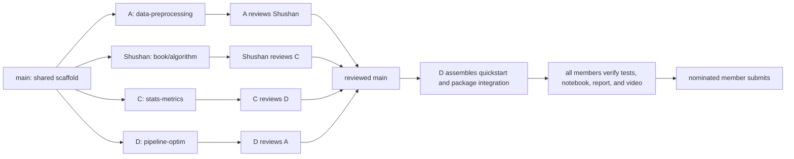

# NumCompute group assignment

NumCompute is a four-person Python and NumPy scientific-computing toolkit. This
repository starts with a shared package scaffold on `main`; each member develops
and tests only their allocated area on a separate branch. Reviewed pull requests
are then integrated into the final package, notebook, report, and video.

Read [GROUP_ALLOCATION.md](GROUP_ALLOCATION.md) before starting. It defines the
files, demonstrations, reviews, and completion criteria owned by every member.
The saved course-page printout and core specification are mapped in
[ASSIGNMENT_REQUIREMENTS.md](ASSIGNMENT_REQUIREMENTS.md).
Actual completed work must be recorded in
[CONTRIBUTIONS.md](CONTRIBUTIONS.md).

## Course-page requirements snapshot

The locally saved printout of the university course page displays
**26 October 2026** and states that submission is due at **9:00 am on the Monday
after the mid-semester break**. Verify the live course page before submission.
The printout describes group work for 3–4 students, worth 30%, using only plain
Python and NumPy—no pandas, scikit-learn, PyTorch, or other external data/ML
libraries.

The group submission requires a Git repository, at least 20 meaningful unit
tests, an end-to-end `demo/quickstart.ipynb`, reproducible benchmarks, a video of
at most five minutes, and a PDF report of at most four pages.

## Installation and preprocessing checks

Python 3.10 or newer is required. NumPy 1.24 or newer is the
only runtime dependency.

Download and extract the repository ZIP, or clone the repository.
Open a terminal in the project folder containing `pyproject.toml`.

Install the package and its dependency:

```sh
python -m pip install -e .
```

The editable installation uses the code in this project folder,
so saved code changes are available without reinstalling.

Run the CSV and preprocessing tests:

```sh
python -m unittest discover -s tests -p test_io_preprocessing.py -v
```

Run the preprocessing demonstration:

```sh
python -m demo.preprocessing_demo
```

The demonstration uses `demo/data/sample.csv` and prints the
output shapes. It fits the preprocessing tools on the training
rows and reuses those fitted values for the test rows.

## Branch ownership

| Member | Area | Branch |
|---|---|---|
| A: pending | CSV I/O and preprocessing | `data-preprocessing` |
| Shushan | Sorting, searching, ranking, and percentiles | `book/algorithm` |
| C: pending | Statistics, metrics, and benchmarking | `stats-metrics` |
| D: pending | Pipelines, optimisation, utilities, and integration | `pipeline-optim` |

Members A, C, and D should replace `pending` with their names and GitHub
usernames. Branch ownership includes implementation, tests, documentation,
explanation, and review—not merely creating files.

## Required shared outputs

The repository is not complete when the module code passes. The group must also
produce:

- `demo/data/sample.csv`, supplied by A, with numeric values, ties, categories,
  and missing data suitable for the demonstrations;
- `demo/quickstart.py` and `demo/quickstart.ipynb`, assembled by D from examples
  supplied by all four members;
- `demo/check_notebook.py`, maintained by D, to execute notebook code in order;
- reproducible benchmark code and recorded results, owned by C;
- a technical report within the assignment page limit, assembled from each
  member's written section;
- a demonstration video within the assignment time limit, with every member
  explaining their own work;
- an accurate contribution and review record in `CONTRIBUTIONS.md`.

## Quickstart ownership

D coordinates the quickstart, but does not write everyone else's content:

- A supplies CSV loading and preprocessing examples plus the sample dataset.
- Shushan supplies sorting, top-k, quickselect, binary-search, ranking, and percentile
  examples with expected outputs.
- C supplies statistics, evaluation-metric, and benchmark examples.
- D supplies pipeline, gradient/Jacobian, and utility examples, combines all
  sections, and verifies the script and notebook from a fresh environment.

## Branch workflow



Create an assigned branch from `main`, never from another member's unfinished
branch:

```sh
git clone https://github.com/bookmountain/numcompute-review.git
cd numcompute-review
git switch -c <assigned-branch> origin/main
git push -u origin <assigned-branch>
```

Commit with your own Git identity. Before requesting review, run your scoped
tests, document important edge cases and complexity, and add at least one
meaningful test. Open a pull request into `main`; the reviewer named in the
allocation must approve it before integration.

## Definition of done

A member's allocation is complete only when:

1. Their required functions and error behaviour are implemented.
2. Their scoped tests pass and cover ordinary and edge cases.
3. They can explain the algorithms, shapes, numerical choices, and limitations.
4. They have supplied their quickstart, report, and video material.
5. Their assigned cross-review is recorded with a commit or pull-request link.
6. Their actual contribution row is completed in `CONTRIBUTIONS.md`.

After all module pull requests are merged, D creates the integration branch,
assembles the quickstart, runs the complete test suite and notebook, and opens
the final integration pull request. The entire group reviews the final result.
